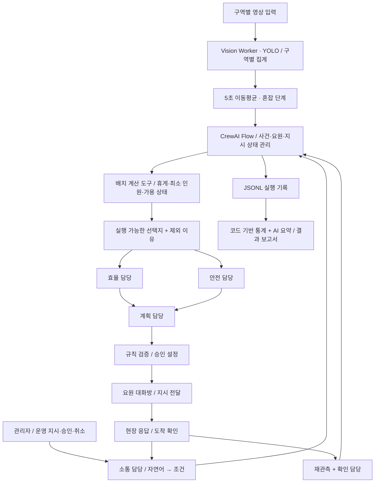
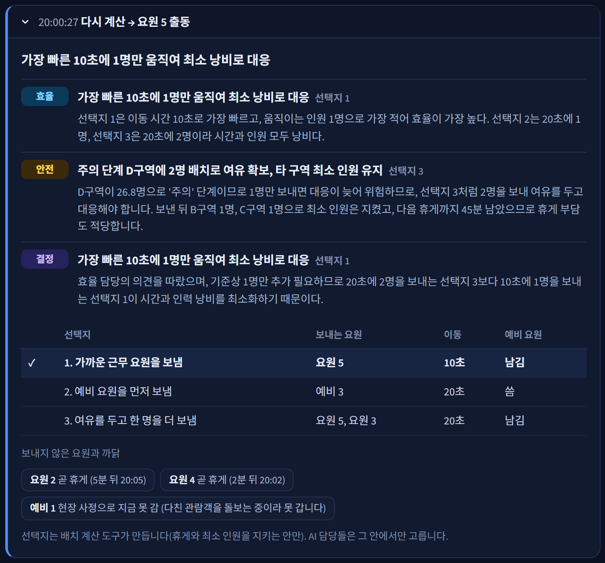
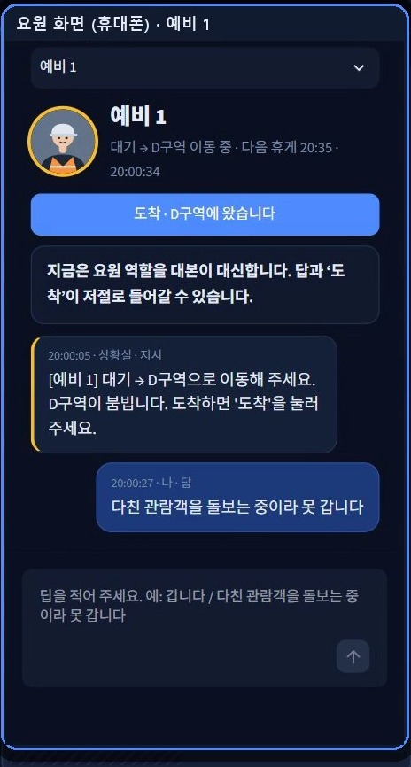
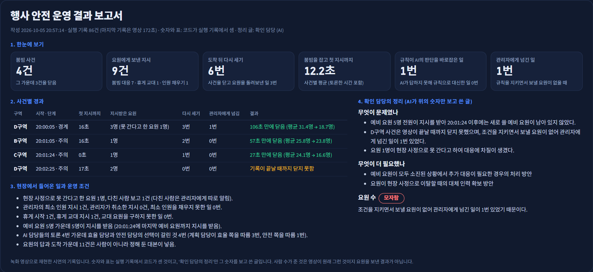

# 경남 AI/SW 경진대회 최우수상 수상작

## CrowdFlow Agent

**영상 기반 군중 관측과 멀티 에이전트 의사결정을 연결한 안전요원 재배치 시스템**

제4회 경남 AI·SW 경진대회 대학부 **최우수상 수상** · 2026 · 팀 정삼인들

Python · CrewAI Flow · YOLO · Ollama · Streamlit

CrowdFlow Agent는 행사장의 혼잡 상황과 안전요원의 근무 조건을 함께 분석해 배치를 결정하고, 지시 전달부터 도착 확인·재배치·운영 보고서까지 연결합니다. 자연어를 해석하는 AI와 운영 제약을 계산하는 코드의 책임을 분리해, 설명 가능한 판단과 관리자의 통제를 하나의 시스템으로 구현했습니다.

[시스템 구조](#architecture) · [GUI](#gui) · [검증 결과](#validation) · [실행 방법](docs/SETUP.md)

## Highlights

| 구현 영역 | 결과 |
|---|---|
| End-to-end 운영 | 영상 관측 → 배치 계획 → 지시 → 현장 응답 → 도착 후 재확인 → 복귀 → 보고서 |
| 역할 기반 협업 | 소통·효율·안전·계획·확인 담당으로 구성한 5개 AI 역할 |
| 제약 기반 배치 | 휴게 시간, 구역별 최소 인원, 현재 이동·업무 상태를 반영한 후보 생성 |
| Human-in-the-loop | 관리자 자연어 지시로 최소 인원 갱신, 지시 취소, 설정에 따른 승인 후 실행 |
| 의사결정 가시화 | 담당별 의견, 선택된 배치안, 후보 요원과 제외 이유를 화면에서 확인 |
| 운영 리포팅 | 실행 기록에서 집계한 KPI·사건별 표와 AI 요약을 결합한 결과 보고서 |

## Problem & Approach

행사 운영에서는 혼잡 구역을 파악한 뒤에도 **누구를 어디로 보낼지** 결정해야 합니다. 이동 거리뿐 아니라 휴게 일정, 다른 구역에 남겨야 할 인원, 현장의 이동 불가 사유까지 함께 고려해야 합니다.

1. **Perception** — 영상에서 사람을 검출하고 구역별 인원과 혼잡 단계를 계산합니다.
2. **Planning** — 규칙 계산으로 실행 가능한 배치안을 만든 뒤, AI 담당들이 효율과 안전 관점의 의견을 제시하고 계획 담당이 선택합니다.
3. **Execution & Feedback** — 지시와 현장 응답을 상태에 반영하고, 도착 후 관측 결과에 따라 종료·관찰·추가 투입을 판단합니다.

<a id="architecture"></a>
## Architecture



### AI와 도구의 역할 분리

| 구성 요소 | 책임 | 구현 |
|---|---|---|
| 소통 담당 | 관리자 최소 인원 지시와 요원의 현장 응답을 구조화 | [agents.py](src/crowdflow/agents.py) |
| 효율·안전 담당 | 같은 배치 후보를 서로 다른 관점에서 평가 | [agents.py](src/crowdflow/agents.py) |
| 계획 담당 | 후보 안에서 배치안을 선택하고 근거 제시 | [agents.py](src/crowdflow/agents.py) |
| 확인 담당 | 재관측 결과 해석, 보고서 요약 | [agents.py](src/crowdflow/agents.py) |
| 배치 도구 | 가용 요원 계산, 선택지 생성, 제외 이유 산출 | [staffing.py](src/crowdflow/staffing.py) |
| 상태·실행 제어 | 사건 생명주기, 휴게 교대, 승인·취소, 재배치 | [flow.py](src/crowdflow/flow.py) |

**AI는 계산 도구가 만든 선택지 안에서 판단합니다.** 관리자가 지정한 최소 인원은 다음 계산의 조건이 되고, 현장 요원이 이동할 수 없다고 응답하면 해당 상태를 반영해 다시 계획합니다. 정량적 종료 조건은 코드가 확인합니다.

### Runtime

- **Frontend:** Streamlit 기반 상황실, 모바일 요원 화면, 결과 보고서.
- **Vision:** 별도 GPU worker에서 사람 검출 및 영상 스트림 제공.
- **Agent runtime:** CrewAI + Ollama로 로컬 LLM 추론. 외부 LLM API 호출 없이 구성.
- **State & records:** 메모리의 운영 상태와 JSONL 이벤트·대화 기록.
- **Configuration:** 모델, 혼잡 기준, 이동 시간, 승인 방식 등을 YAML로 관리.

<a id="gui"></a>
## GUI

### 상황실 대시보드

4개 구역의 영상, 가상 약도, 구역별 혼잡 상태, 요원 배치·휴게·이동 상태와 AI 결정을 한 화면에서 확인합니다. 관리자는 자연어로 최소 인원을 변경하고 전달된 지시를 취소할 수 있습니다.

### 설명 가능한 결정 카드

효율·안전 담당의 의견, 계획 담당의 선택, 후보별 이동 시간과 제외 이유를 함께 표시합니다.



### 모바일 요원 화면

요원은 지시를 확인하고, 현장 사정을 자연어로 전달하거나 도착을 알립니다. 아래 화면은 시연 대본을 사용하는 모드입니다.



### 운영 결과 보고서

보고서 생성 버튼을 누르면 사건 수, 지시 내역, 재확인과 복귀 기록을 집계하고 AI가 요약합니다. **수치와 표는 코드가 생성하고, AI는 집계된 결과를 설명합니다.**



<a id="validation"></a>
## Validation

최종 제출 시점의 시험·측정 결과입니다. 개발 과정의 변경 기록 대신 결과와 측정 범위를 정리했습니다.

| 검증 항목 | 결과 | 범위 |
|---|---:|---|
| 대표 시나리오 | **8종 × 2회 모두 통과** | 실제 AI 담당을 포함한 운영 흐름 |
| 지시 규칙 준수 | **142건 중 위반 0건** | 휴게·최소 인원 등 배치 규칙에 대한 기록 점검 |
| 자동 테스트 | **73개 통과** | 최종 개발 환경, 분석 자료 포함 |
| 자연어 해석 | **16문장 중 16문장** | 준비한 입력 문장에 대한 조건·상태 해석 |
| 감지 → 지시 | **13–17초** | 측정한 사건 18건, AI 판단 시간 포함 |
| 사람 수 오차 | **0.47–0.78명** | 정답이 있는 별도 QUT 평가 자료에서 측정 |

자세한 시험 범위는 [검증 결과](docs/VALIDATION.md)에 정리했습니다. 수치는 서로 다른 시험 집합의 결과이며, 현장 운영 성과를 나타내는 값은 아닙니다.

### Demo configuration

**녹화 영상으로 재현**한 시연입니다. AI Hub 영상 12개를 4개 가상 구역에 연결하고 모의 요원 13명으로 운영 흐름을 검증했습니다. 사람 검출은 실행 중 GPU에서 수행하며, 영상의 인원 변화는 녹화된 장면의 변화입니다. 혼잡 기준과 이동 시간은 시연용 설정입니다.

## Quick Start

Python 3.11–3.13, uv, Ollama와 GPU 환경을 사용합니다. 원본 영상과 모델 가중치는 저장소에 포함하지 않습니다. 데이터 준비와 모델 설정을 포함한 전체 절차는 [Setup](docs/SETUP.md)을 참고하세요.

```bash
uv sync --locked
ollama serve
```

별도 터미널에서:

```bash
uv run --locked streamlit run src/crowdflow/app.py
```

| 화면 | 주소 |
|---|---|
| 상황실 | `http://localhost:8501` |
| 현장 요원 | `http://localhost:8501/staff` |
| 결과 보고서 | `http://localhost:8501/report` |

```bash
uv run --locked pytest -q tests
```

## Repository

```text
src/crowdflow/     에이전트, 상태 제어, 영상 분석, 배치 계산, GUI
config/           운영 설정, 모의 요원, 가상 구역 구성
tests/            단위 테스트와 대표 시나리오
knowledge/        운영 지침 자료
docs/             실행 방법, 검증 결과, GUI 이미지
pyproject.toml    Python 의존성
uv.lock           재현 가능한 의존성 잠금 파일
```

## Award & Credits

- **제4회 경남 AI·SW 경진대회 · 대학부 · 최우수상**
- 팀 프로젝트: **정삼인들**
- 신청 분야: **(33) 3-3. 제조 피지컬 AI — 우리 삶과 산업을 바꾸는 AI Agent**

CrewAI, Ultralytics YOLO, Streamlit, Ollama 등 오픈소스를 활용했습니다. 코드 작성, 문서 초안 및 시연 제작에 Claude Code를 사용했으며, 주제·운영 규칙 결정과 실행 확인은 팀이 수행했습니다. 데이터와 소프트웨어의 출처는 [Third-party notices](THIRD_PARTY_NOTICES.md)를 참고하세요.
